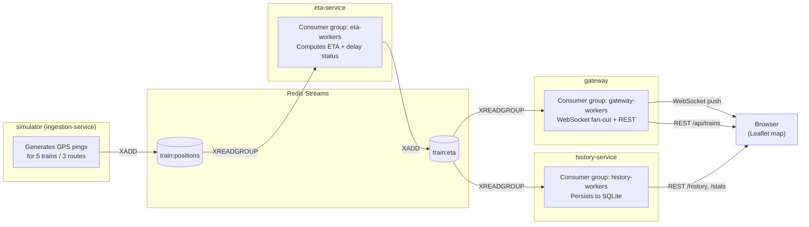

# Live Train Tracker

A small event-driven microservices system that simulates a fleet of trains
moving along real-world-ish routes, streams their positions through Redis,
enriches them with ETA/delay calculations, and shows them moving live on a
map over a WebSocket connection.

Built to be fast to stand up (`docker compose up`) while still demonstrating
patterns that show up in real backend/distributed-systems interviews: an
event-streaming pipeline, consumer groups, an API gateway, and a persistence
layer, each as an independently deployable service.

## Architecture



Each arrow into Redis is a separate consumer group, which is the detail
worth explaining in an interview: `eta-service`, `gateway`, and
`history-service` each read the stream independently, at their own pace,
with their own replay position and their own acknowledgment tracking. Kill
`history-service` for ten seconds and restart it — it resumes exactly where
it left off instead of losing data, which a plain pub/sub channel could not
give you.

## Services

| Service | Responsibility | Port |
|---|---|---|
| `simulator` | Generates simulated GPS pings for 5 trains across 3 routes, publishes to `train:positions` | — |
| `eta-service` | Consumes positions, computes ETA + delay classification, publishes to `train:eta` | — |
| `gateway` | Consumes `train:eta`, broadcasts over WebSocket, serves the map UI and a REST snapshot | 8000 |
| `history-service` | Consumes `train:eta`, persists to SQLite, exposes historical/aggregate REST endpoints | 8001 |
| `redis` | Message broker (Streams) | 6379 |

## Quickstart

Requires Docker + Docker Compose.

```bash
docker compose up --build
```

Then open **http://localhost:8000** — you'll see trains moving live on the
map within a couple of seconds, with a side panel showing ETA and delay
status per train.

Other endpoints to poke at:

```bash
curl http://localhost:8000/health          # gateway health + connected client count
curl http://localhost:8000/api/trains      # current snapshot of all trains
curl http://localhost:8001/history/101A    # recent history for one train
curl http://localhost:8001/stats/delays    # aggregate delay counts per route
```

To scale the ETA layer horizontally (Redis Streams will load-balance work
across replicas in the same consumer group):

```bash
docker compose up --build --scale eta-service=3
```

### Running without Docker

Each service is a standalone Python app that only needs a `REDIS_URL`.
Start Redis locally, then in separate terminals:

```bash
pip install -r services/simulator/requirements.txt      && python services/simulator/app/main.py
pip install -r services/eta-service/requirements.txt    && python services/eta-service/app/main.py
pip install -r services/gateway/requirements.txt        && (cd services/gateway/app && uvicorn main:app --reload)
pip install -r services/history-service/requirements.txt && (cd services/history-service/app && uvicorn main:app --port 8001 --reload)
```

## What this project demonstrates

- **Event-driven architecture** with Redis Streams (`XADD`/`XREADGROUP`/`XACK`) instead of a naive shared database, including durable, replayable, independently-paced consumers
- **Horizontal scalability** via consumer groups — `docker compose up --scale eta-service=3` just works
- **A real-time API gateway** pattern: one WebSocket-facing service fans data out to many clients, decoupled from the services doing the actual processing
- **Polyglot persistence boundary** — `history-service` owns its own SQLite store; nothing else touches it directly, so it could be swapped for Postgres/Timescale without touching other services
- **Independent deployability** — each service has its own Dockerfile, its own dependencies, and can be restarted/scaled/replaced without touching the others
- **Graceful degradation** — if a downstream consumer (gateway or history-service) goes down, positions and ETA events keep flowing through Redis and get replayed once it's back, rather than being lost

## Stretch goals (good next steps if you want to go further)

Roughly ordered by effort vs. resume impact:

1. **Tests** — unit test the ETA/delay-classification logic and an integration test that spins up Redis via `testcontainers` and asserts an event makes it end-to-end.
2. **Observability** — add Prometheus metrics (`prometheus-fastapi-instrumentator`) to `gateway`/`history-service` and a Grafana dashboard; add OpenTelemetry tracing across the pipeline so a single train event can be traced from `simulator` through to the browser.
3. **Kubernetes** — write Helm charts or plain manifests, deploy to a local `k3d`/`minikube` cluster, and add a `HorizontalPodAutoscaler` on `eta-service`.
4. **Real data** — swap the simulator for a real GTFS-realtime feed (many transit agencies publish these publicly) so the "fake" part of the demo goes away entirely.
5. **CI/CD** — GitHub Actions workflow that builds each service's image, runs tests, and pushes to a registry on merge to main.
6. **Auth + rate limiting** on the gateway's public endpoints.

## Project layout

```
train-tracker/
├── docker-compose.yml
└── services/
    ├── simulator/         # ingestion: generates + publishes GPS events
    ├── eta-service/        # enrichment: ETA + delay computation
    ├── gateway/             # API gateway: WebSocket fan-out, REST, static UI
    └── history-service/    # persistence: SQLite-backed history/stats API
```
